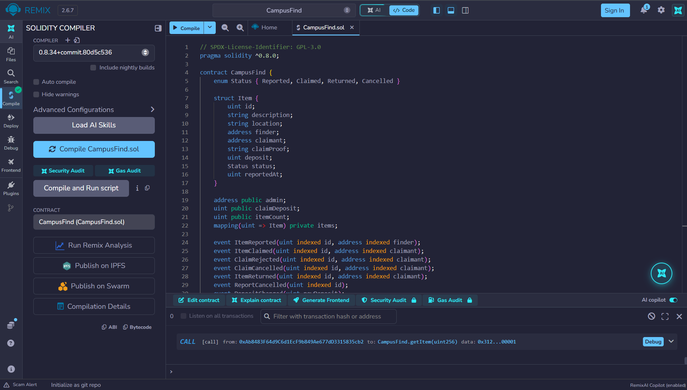
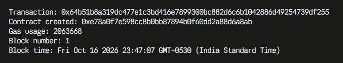
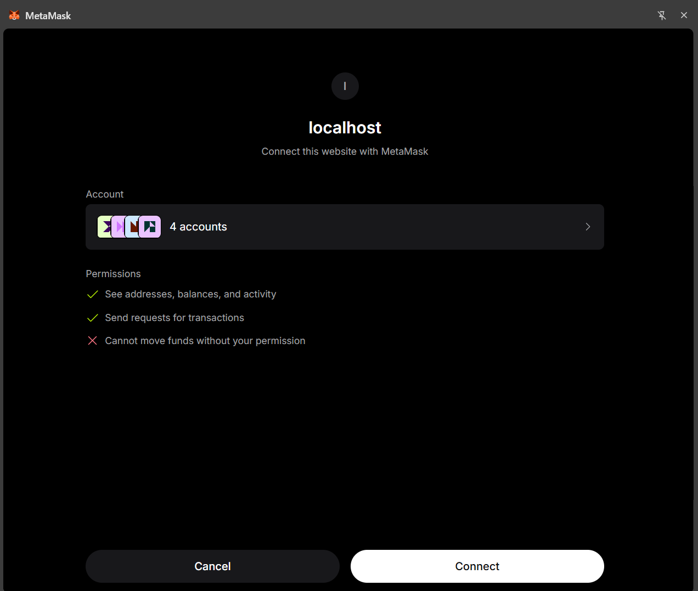
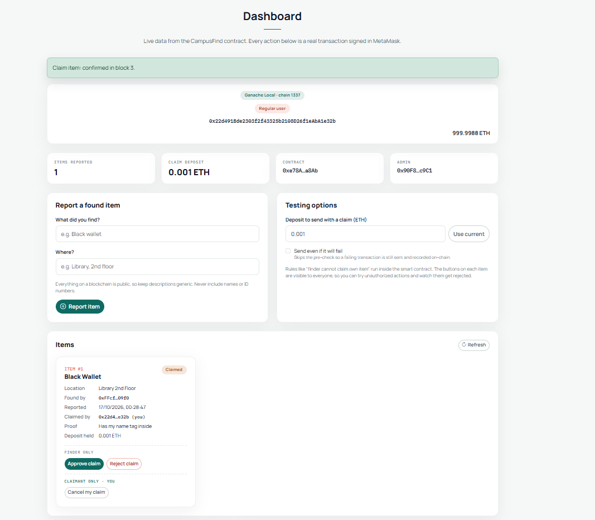
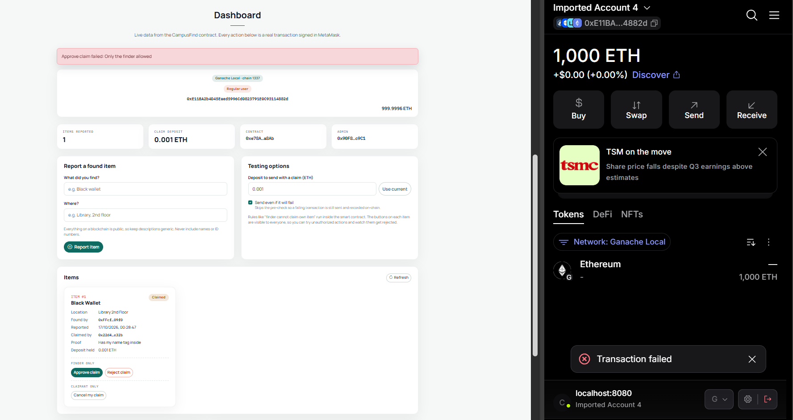
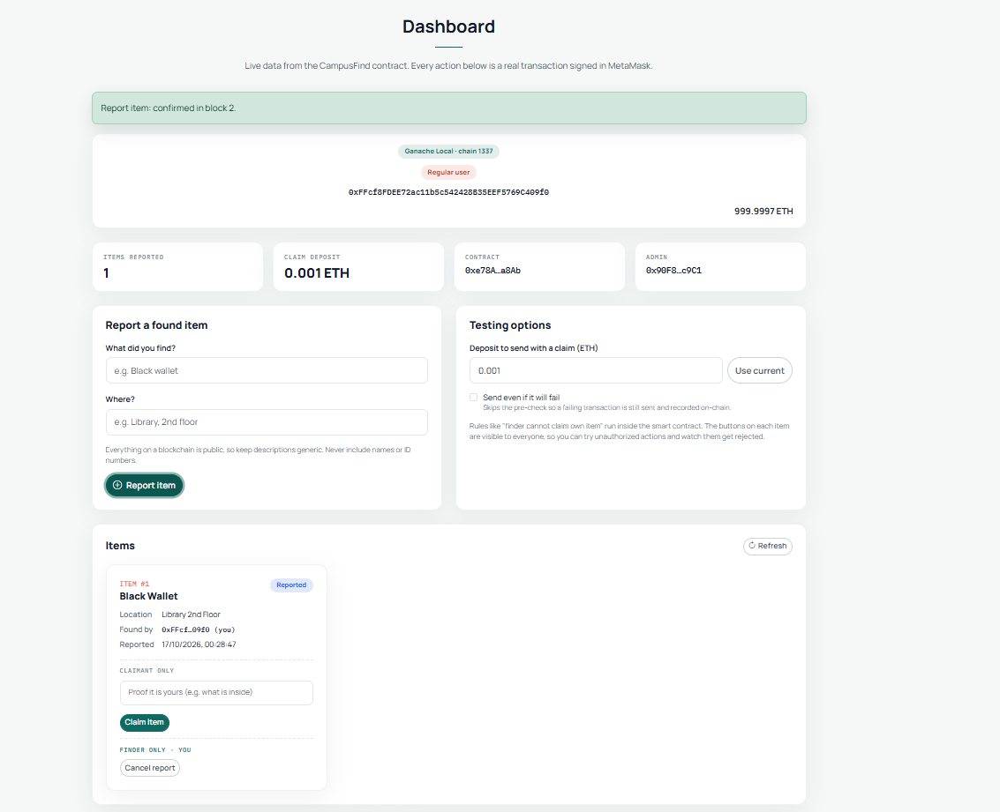

# CampusFind: Blockchain Lost & Found DApp

A decentralized application (DApp) for reporting and recovering lost items on a university campus. A Solidity smart contract on Ethereum records every report, claim and handover, and a small web front end talks to it through MetaMask.

Built for **Blockchain Technology (CSE4444), Assignment 2**.

## 1. The problem

Lost-and-found on campus usually means a notice board or a security desk. There is no reliable record of who found what, who claimed it, and whether it was really handed back, and nothing stops a stranger from claiming something that is not theirs.

CampusFind puts that process on a blockchain:

- **Finders** report an item. The report is stored on-chain with the finder's wallet address and a timestamp.
- **Owners** claim an item by submitting a short proof and a small **refundable deposit** (default 0.001 ETH). The deposit discourages false claims.
- **Only the finder** can approve or reject a claim. Approval marks the item *Returned* and refunds the deposit. A rejected or cancelled claim also refunds the deposit.
- **An admin** (the account that deployed the contract) can change the deposit amount.
- Every step is a transaction, and the contract emits an event for each state change, so the history cannot be quietly edited.

### Item lifecycle

```
Reported ──claim──▶ Claimed ──approve──▶ Returned
   ▲                   │
   └─ reject / cancel ─┘
Reported ──finder cancels report──▶ Cancelled
```

## 2. Repository layout

```
campus-find/
├── contracts/
│   └── CampusFind.sol          Solidity smart contract
├── frontend/
│   ├── index.html              Page (hero, how it works, dashboard)
│   ├── app.js                  MetaMask + Ethers.js logic
│   └── assets/                 CSS theme, Bootstrap, icons, Ethers.js (bundled, no CDN needed for scripts)
├── screenshots/                Evidence screenshots used below
└── README.md
```

## 3. Smart contract (`contracts/CampusFind.sol`)

| Function | Who may call it | Purpose |
|---|---|---|
| `constructor(claimDeposit)` | deployer | Sets the admin and the claim deposit (must be > 0) |
| `reportFound(description, location)` | anyone | Creates an item (both fields required) |
| `claimItem(id, proof)` *(payable)* | anyone except that item's finder | Claims an item; must send exactly `claimDeposit` and a non-empty proof |
| `approveClaim(id)` | the item's finder | Item becomes *Returned*, deposit refunded |
| `rejectClaim(id)` | the item's finder | Deposit refunded, item back to *Reported* |
| `cancelClaim(id)` | the claimant | Withdraws the claim, deposit refunded |
| `cancelReport(id)` | the item's finder | Withdraws an unclaimed report |
| `setClaimDeposit(amount)` | admin only | Changes the deposit (must be > 0) |
| `getItem(id)` | anyone (view) | Returns the item record |

Design notes:

- State: an `Item` struct stored in a `mapping(uint => Item)`, a `Status` enum (`Reported, Claimed, Returned, Cancelled`), `admin`, `claimDeposit` and `itemCount`.
- Validation uses `require` with readable messages, plus modifiers `onlyAdmin`, `onlyFinder`, `onlyClaimant`, `itemExists` and `inStatus`.
- Events are emitted for every change: `ItemReported`, `ItemClaimed`, `ClaimRejected`, `ClaimCancelled`, `ItemReturned`, `ReportCancelled`, `DepositChanged`.
- Refunds follow checks-effects-interactions: state is updated before ETH is sent.

## 4. Deployment details

| | |
|---|---|
| Network | Ganache (local), **chain ID 1337** |
| RPC URL | `http://127.0.0.1:7545` |
| Contract address | `0xe78A0F7E598Cc8b0Bb87894B0F60dD2a88d6a8Ab` |
| Deployer / admin | `0x90F8bf6A479f320ead074411a4B0e7944Ea8c9C1` (Ganache account 0) |
| Deployment transaction | `0x64b51b8a319dc477e1c3bd416e7899300bc882d6c6b1042886d49254739df255` |
| Block / gas used | block 1 / 2,063,668 |
| Constructor argument | `1000000000000000` wei (0.001 ETH) |
| Compiler | Solidity 0.8.34 (Remix), EVM version `paris` |

## 5. How to run it

### Prerequisites

- [Node.js](https://nodejs.org) (to run Ganache with `npx`)
- [MetaMask](https://metamask.io) browser extension
- [Remix IDE](https://remix.ethereum.org) (browser) to compile and deploy
- Python 3 (or any static file server) to serve the front end

### Step 1: start a local blockchain

```bash
npx ganache --server.port 7545 --chain.chainId 1337 --wallet.deterministic
```

Leave it running. It prints 10 test accounts with 1000 ETH each, and their private keys. `--wallet.deterministic` makes the accounts the same on every start. These keys are **public test keys**: never use them on a real network.

### Step 2: compile and deploy with Remix

1. In Remix, create `contracts/CampusFind.sol` and paste in the contract.
2. **Solidity Compiler** tab: compiler 0.8.x, open *Advanced Configurations* and set **EVM Version to `paris`** (Ganache's EVM is older than Remix's default, and newer opcodes fail with "invalid opcode"). Click **Compile**.
3. **Deploy & Run** tab: set **Environment** to *Custom - External Http Provider* (or *Dev - Ganache Provider*) and enter `http://127.0.0.1:7545`.
4. Select Ganache account 0 (`0x90F8…c9C1`), set the constructor argument `_claimDeposit` to `1000000000000000`, and click **Deploy**.
5. Copy the deployed contract address. If you deploy first from account 0 on a fresh deterministic Ganache you get `0xe78A…a8Ab`, the address already set in `frontend/app.js`. Otherwise update `CONTRACT_ADDRESS` at the top of `frontend/app.js`.

### Step 3: set up MetaMask

1. Add a custom network: name `Ganache Local`, RPC URL `http://127.0.0.1:7545`, chain ID `1337`, currency `ETH`.
2. Import Ganache accounts using **Import account → Private Key** (copy the keys from the Ganache terminal; do **not** import the recovery phrase). Import at least four so each role can be tried:

| Ganache account | Role in the tests |
|---|---|
| 0 | Admin (deployer) |
| 1 | Finder |
| 2 | Claimant |
| 3 | Stranger (no special rights) |

### Step 4: run the front end

```bash
python -m http.server 8080 --directory frontend
```

Open **http://localhost:8080**, click **Connect MetaMask** and, in MetaMask's connect dialog, select all four accounts. The page asks MetaMask to switch to *Ganache Local* if needed. Switch accounts in MetaMask to act as the different roles; the page updates automatically.

### Using the dashboard

- **Report a found item**: description and location, then confirm the transaction in MetaMask.
- **Claim item**: type a proof on the item card and send the deposit.
- **Approve / Reject claim**, **Cancel my claim**, **Cancel report**: shown on each item under the role allowed to use them. The buttons are visible to everyone on purpose, so unauthorized attempts can be tested.
- **Testing options**: edit the deposit amount sent with a claim (to try a wrong amount), and tick **Send even if it will fail** to skip the pre-check so a failing transaction is still sent and recorded on-chain.
- **Admin: claim deposit**, **Transactions this session** and **On-chain activity** (events read from the blockchain).

## 6. Test cases and results

Test accounts: **Admin** = account 0, **Finder** = account 1, **Claimant** = account 2, **Stranger** = account 3 (Ganache numbering). In the Remix VM runs below, Remix's own simulated accounts 1 to 4 played these roles in the same order.

### A. Contract tests in the Remix VM (before deploying to Ganache)

| # | Category | Actor | Call | Observed result |
|---|---|---|---|---|
| 1 | Valid | Finder | `reportFound("Black Wallet", "Library 2nd Floor")` | Success, item 1 stored with status Reported |
| 2 | Valid | Claimant | `claimItem(1, "Blue student card inside")` with 0.001 ETH | Success, status Claimed, 0.001 ETH held |
| 3 | Valid | Finder | `approveClaim(1)` | Success, status Returned, deposit refunded, `ItemReturned` emitted |
| 4 | Unauthorized | Stranger | `setClaimDeposit(5)` | Reverted: "Only admin allowed", no state change |
| 5 | Invalid | Finder | `reportFound("", "Gate")` | Reverted: "Description required", no item stored |
| 6 | Invalid | Finder | `getItem(99)` | Reverted: "Item does not exist" |
| 7 | Valid | Finder | `reportFound("Water Bottle", "Cafeteria")` | Success, item 2 stored, `ItemReported` emitted |
| 8 | Invalid | Claimant | `claimItem(2, "mine")` with 0 ETH | Reverted: "Incorrect deposit amount" |
| 9 | Unauthorized | Finder | `claimItem(2, "mine")` with 0.001 ETH, on their own item | Reverted: "Finder cannot claim own item" |
| 10 | Valid | Claimant | `claimItem(2, "Black bottle with a sticker")` with 0.001 ETH | Success, item 2 Claimed, `ItemClaimed` emitted |
| 11 | Unauthorized | Stranger | `approveClaim(2)` | Reverted: "Only the finder allowed" |
| 12 | Unauthorized | Stranger | `cancelClaim(2)` | Reverted: "Only the claimant allowed" |

### B. End-to-end tests through the web UI on Ganache with MetaMask

| # | Category | Actor | Action in the UI | Observed result |
|---|---|---|---|---|
| 13 | Valid | Finder (`0xFFcf…09f0`) | Report item "Black Wallet", "Library 2nd Floor" | Confirmed in block 2; item 1 shown as Reported |
| 14 | Valid | Claimant (`0x22d4…e32b`) | Claim item 1 with proof "Has my name tag inside", 0.001 ETH deposit | Confirmed in block 3; item shown as Claimed, 0.001 ETH deposit held |
| 15 | Unauthorized | Stranger (`0xE11B…882d`) | Approve claim on item 1, with "Send even if it will fail" ticked | Transaction mined but reverted: "Only the finder allowed"; MetaMask shows "Transaction failed"; item stays Claimed |

## 7. Screenshots

**Smart contract compilation** (Remix, compiler 0.8.34, EVM version `paris`)



**Smart contract deployment** (Ganache log: contract created at `0xe78A…a8Ab`)



**MetaMask wallet connection** (connecting the site to four accounts)



**Successful transaction** (claiming an item with a 0.001 ETH deposit, confirmed in block 3)



**Failed transaction** (a non-finder tries to approve a claim: "Only the finder allowed")



**Blockchain data displayed through the user interface** (live stats and an item read from the contract)



Additional evidence is in `screenshots/extra/`: the MetaMask confirmation dialogs for the claim (with the 0.001 ETH amount) and for the failing approval, and the successful and failed Remix VM transactions from test section A.

## 8. Limitations and security notes

- **Public data.** Everything on a blockchain is readable by anyone, so item descriptions and claim proofs should be generic. Never put names or ID numbers in them.
- **Trust in the finder.** The finder decides whether a claim is genuine. The physical handover happens off-chain, and the blockchain provides the audit trail.
- **Refund by direct transfer.** Refunds are sent straight to the claimant. A claimant that is a contract refusing ETH could stall its own claim. A pull-payment (withdraw) pattern would avoid that, but was left out to keep the contract simple.
- **No private keys in this repository.** The Ganache keys are deterministic test keys that live only in the Ganache terminal. Do not commit keys, recovery phrases or passwords.

## 9. Tech used

Solidity 0.8, Remix IDE, Ganache, MetaMask, Ethers.js v6, Bootstrap 5, HTML / CSS / JavaScript.
